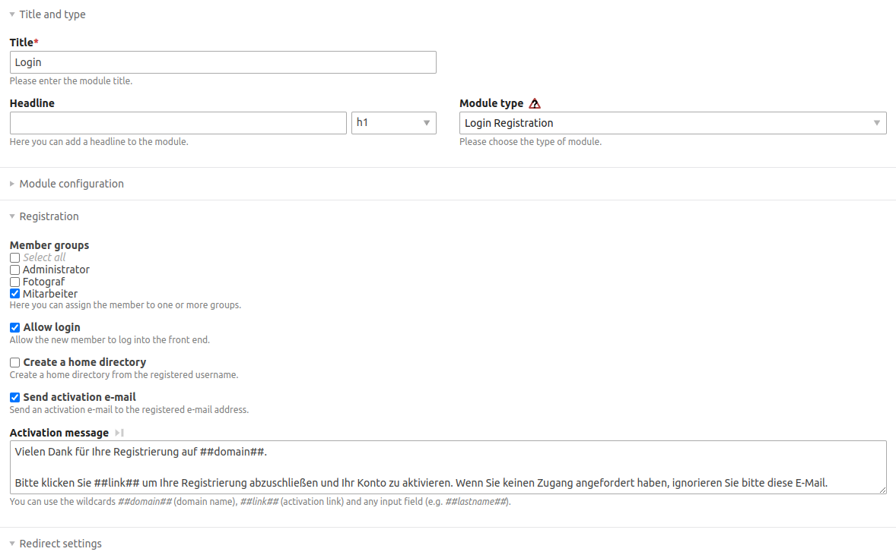

# Contao Login Registration Bundle

This bundle provide a login frontend module allowing direct register the user if user not exist.



## Usage

### Install

Install with contao manager or with composer: 

```bash
composer require heimrichhannot/contao-login-registration-bundle
```

Update the database.

### Compatibility

The development branch adds Symfony 7 and Contao 5.7 compatibility while retaining Contao
4.13 and Symfony 5.4/6 support. It requires PHP 8.1 or newer; the selected Contao
and Symfony versions may require a newer PHP version.

The frontend module type, configuration fields and registration events stay the
same. These changes fix provider delegation and bundle compatibility; they do
not require a bundle-specific database migration.

### Setup

1. Create a frontend module of type "Login Registration".
2. Add the module to a page.
3. For ease of usage, it is recommended to only allow email addresses as username. 
   You could adjust your dca accordingly or use a bundle to provide such functionality. 
   Otherwise, you need to implement a listener for `PrepareNewMemberDataEvent` to provide a user email address.

## Developers

### Compatibility tests

The standalone tests use real Contao/Symfony classes and in-memory collaborators.
They verify password upgrades, lookup and refresh delegation, adjusted usernames,
invalid registration contexts, concrete provider compatibility and frontend-only
service decoration. They do not create members, access a database or send mail.

Install an isolated test fixture and run it, for example for Contao 5.7:

```bash
composer update --working-dir=tests/compatibility \
  --with='contao/core-bundle:^5.7' --with='symfony/security-core:^7.4'
php tests/CompatibilityTest.php tests/compatibility/vendor/autoload.php
```

CI also runs Contao 4.13/Symfony 5.4 on PHP 8.1 and Contao 5.3/Symfony 6.4 on
PHP 8.2. To reuse an existing local Contao installation, pass its
`vendor/autoload.php` instead. The test bootstrap explicitly loads this checkout's
bundle source. With dependencies installed in the repository root, `composer test`
runs the same checks.

The historical Contao 4.13 dependency set has upstream security advisories. Its
isolated CI install uses `--no-security-blocking` to exercise backward
compatibility and still reports the audit result. This exception is limited to
the test job; normal package/application installs keep Composer's security checks.

Package versions are managed through Git tags, as in earlier releases. A project
using a temporary Symfony 7 patch can switch to a tagged package once a release
containing these changes has been published.

Real registration, activation and login should also be accepted in the consuming
application with its intended authentication provider and mail transport.

### PHP Events

| Event                     | Description                                                                      |
|---------------------------|----------------------------------------------------------------------------------|
| AdjustUsernameEvent       | Manipulate the username before checking for existing user or creating a new one. |
| PrepareNewMemberDataEvent | Adjust the new member data before the member is created.                         |
| BeforeParseModuleEvent    | Manipulate the template data before rendering the frontend module.               |

#### Exception handling

To pass an exception to the user, you can throw a `\HeimrichHannot\LoginRegistrationBundle\Exception\InvalidRegistrationException` 
in your `PrepareNewMemberDataEvent` or `AdjustUsernameEvent` listener. 
To adjust the message, that will be displayed to the use, use the `BeforeParseModuleEvent`.
